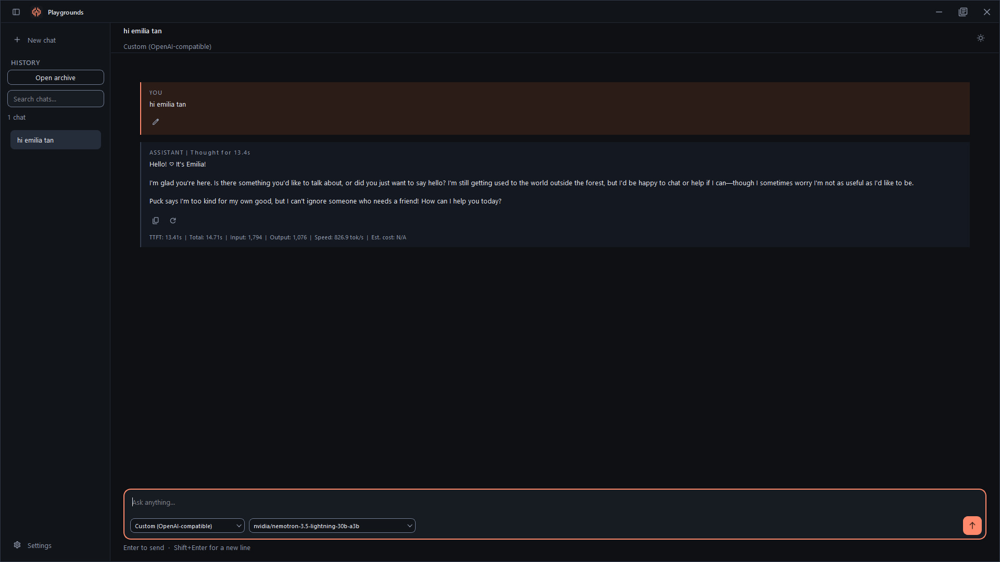
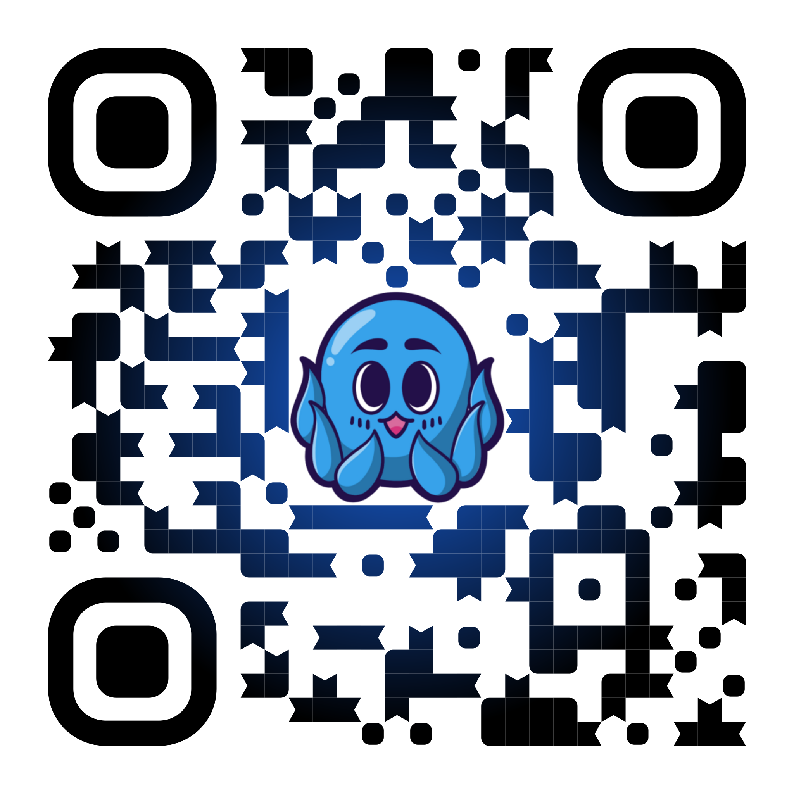

<a id="top"></a>

# Playgrounds

**A lightweight desktop AI playground built with Python and PyQt6 🗿.**

[](#id-unduh)
[](pyproject.toml)
[](pyproject.toml)
[](LICENSE)

**[🇮🇩 Bahasa Indonesia](#bahasa-indonesia) · [🇬🇧 English](#english)**

[📦 Unduh / Download](https://github.com/baaaaan1/Playgrounds/releases/latest) ·
[⚙️ Windows Release](https://github.com/baaaaan1/Playgrounds/actions/workflows/release.yml) ·
[🌐 Panduan lokalisasi / Localization guide](LOCALIZATION.md)

### 🖼️ Tampilan Aplikasi / App Preview

[](build/pic.jpg)

*Klik gambar untuk melihat ukuran penuh. / Click the image to view it at full size.*

---

<a id="bahasa-indonesia"></a>

## 🇮🇩 Bahasa Indonesia

Playgrounds adalah aplikasi desktop berbasis **PyQt6** untuk bereksperimen dengan
endpoint AI yang kompatibel dengan OpenAI. Respons ditampilkan secara bertahap melalui
streaming SSE, dengan profil koneksi terpisah dan penyimpanan API key di Windows
Credential Manager.

> [!NOTE]
> README ini tersedia dalam dua bahasa. Antarmuka aplikasi saat ini hanya tersedia
> dalam **bahasa Inggris (AS)**, tanpa pemilih bahasa atau pergantian bahasa langsung.

### 🧭 Navigasi

| Untuk pengguna | Untuk pengembang dan maintainer |
| --- | --- |
| [Unduh untuk Windows](#id-unduh) | [Mulai dari source](#id-mulai) |
| [Atur koneksi dan model](#id-koneksi) | [Pengembangan dan struktur](#id-pengembangan) |
| [Data dan kredensial](#id-data) | [Build dan installer](#id-build) |
| [Fitur utama](#id-fitur) | [Rilis GitHub](#id-rilis) |
| [Lisensi dan atribusi](#id-lisensi) | [Panduan lokalisasi](LOCALIZATION.md) |
| [Dukung karya saya](#id-dukungan) | |

<a id="id-fitur"></a>

### ✨ Fitur Utama

| Fitur | Detail |
| --- | --- |
| Streaming respons | SSE incremental untuk menampilkan respons secara bertahap. |
| Profil koneksi | Endpoint, model, temperature, max tokens, dan system prompt terpisah untuk setiap koneksi. |
| Penemuan model | Ambil daftar model dari endpoint atau masukkan ID model secara manual. |
| Penyimpanan lokal | Konfigurasi melalui QSettings, percakapan dalam JSON, API key di Credential Manager. |
| Distribusi Windows | Paket PyInstaller `--onedir` dan installer MSI per-user melalui WiX Toolset. |

<a id="id-unduh"></a>

### 📦 Unduh untuk Windows

1. Buka [GitHub Releases terbaru](https://github.com/baaaaan1/Playgrounds/releases/latest).
2. Unduh **`Playgrounds-<versi>-x64.msi`** untuk Windows 10/11 x64.
3. Jalankan installer, lalu buka **Playgrounds** dari Start Menu. **Python tidak perlu dipasang.**
4. Periksa pembaruan melalui **Settings > Updates**.

Jika belum ada rilis publik, tautan Latest belum menyediakan installer. Instalasi
berlaku untuk pengguna saat ini, tanpa UAC. Data pengguna berada di luar folder
instalasi dan bukan bagian dari paket installer; lihat [Data dan kredensial](#id-data)
sebelum menghapus data.

> [!WARNING]
> Build CI saat ini **belum ditandatangani**. Windows dapat menampilkan **Unknown publisher**
> atau peringatan SmartScreen. Jangan melewati peringatan untuk file dari sumber yang
> tidak dipercaya. Checksum bukan pengganti tanda tangan penerbit.

<details>
<summary><strong>🔎 Verifikasi checksum installer</strong></summary>

Setiap rilis menyertakan `SHA256SUMS.txt`. Jalankan perintah berikut di folder unduhan,
sesuaikan versi, lalu cocokkan hash dengan baris nama file tersebut di `SHA256SUMS.txt`.

```powershell
Get-FileHash -LiteralPath .\Playgrounds-0.1.0-x64.msi -Algorithm SHA256
```

Checksum membantu mendeteksi file yang rusak atau berubah.

</details>

<a id="id-mulai"></a>

### 🚀 Mulai dari Source

**Prasyarat pengembangan**

| Komponen | Persyaratan |
| --- | --- |
| Sistem operasi | Windows 10/11 x64 |
| Python | 3.10+ |
| GUI | PyQt6 6.7+, termasuk QtSvg untuk ikon SVG |
| Dependensi pengembangan | Ekstra `.[dev]`, termasuk pytest, Ruff, PyInstaller, dan Pillow |
| Installer MSI | WiX v5+; hanya diperlukan untuk membangun MSI |
| Lingkungan rilis CI | Python 3.12 x64, .NET SDK 8, WiX 5.0.2 |

Dari direktori utama repository, buat virtual environment, pasang dependensi,
lalu jalankan aplikasi:

```powershell
python -m venv .venv
.\.venv\Scripts\python.exe -m pip install -e ".[dev]"
.\.venv\Scripts\python.exe -m app
```

Perintah ini memakai Python virtual environment secara langsung, tanpa aktivasi.
Untuk perintah pengembangan berikutnya, aktifkan environment di terminal yang sama:

```powershell
.\.venv\Scripts\Activate.ps1
```

Jika kebijakan PowerShell membatasi aktivasi, tetap gunakan
`.\.venv\Scripts\python.exe` sebagai pengganti `python`; tidak perlu mengubah kebijakan eksekusi.

<a id="id-koneksi"></a>

### 🔌 Atur Koneksi dan Model

1. Buka **Settings** dengan **Ctrl+,**, lalu buat koneksi bernama.
2. Isi base URL dan API key opsional, kemudian pilih **Fetch models**.
3. Filter daftar model dan klik model yang diinginkan. Jika endpoint tidak menyediakan
   `/models`, ketik ID model secara manual.
4. Pilih **Save connection** untuk menyimpan profil, endpoint, API key, dan daftar model.
5. Pilih koneksi aktif melalui dropdown di toolbar.

> [!IMPORTANT]
> Hasil **Fetch models** belum disimpan sampai **Save connection** dipilih.
> **Cancel** membuang semua perubahan yang belum disimpan, termasuk hasil fetch.

Setiap koneksi menyimpan endpoint, daftar model, temperature, max tokens, system prompt,
dan referensi API key secara terpisah. Beberapa koneksi boleh memakai preset provider
yang sama. **Use preset** hanya mengisi draft aktif, bukan mengganti konfigurasi koneksi lain.

Tombol mata menampilkan atau menyembunyikan teks API key. Key selalu disembunyikan
kembali saat berganti koneksi atau menutup dialog.

<a id="id-pengembangan"></a>

### 🛠️ Pengembangan dan Struktur

Jalankan perintah berikut dari direktori utama repository dengan virtual environment aktif.

**Jalankan aplikasi**

```powershell
python -m app
```

**Jalankan regression test dan lint**

```powershell
python -m pytest
python -m ruff check .
```

Test mencakup profil, kredensial, penemuan model, UI, SSE, dan penyimpanan.
Standar UI English-first, arsitektur terjemahan Qt, dan checklist audit UI yang dapat
diulang tersedia dalam [panduan lokalisasi](LOCALIZATION.md) (bahasa Inggris).

<details>
<summary><strong>🧪 Smoke test tanpa data pengguna</strong></summary>

Jalankan smoke test tanpa membuka jendela, lalu uji backend Windows asli:

```powershell
python -m app --smoke
python -m app --smoke-native
```

Kedua mode memakai konfigurasi dan percakapan sementara, bukan data pengguna.
Skrip build menunggu kedua smoke test pada EXE hasil packaging selesai dan memeriksa exit code.

</details>

<details>
<summary><strong>🗂️ Struktur proyek dan catatan arsitektur</strong></summary>

```text
app/
  core/               Model, profil, QSettings, Credential Manager, penyimpanan JSON
  net/                sse.py, client.py, models.py; penemuan model melalui QNetworkAccessManager
  ui/                 main_window, window_chrome, chat_view, composer, sidebar, settings, theme
  resources/line-md/  SVG Material Line dan lisensi, dibundel untuk penggunaan offline
build/
  playgrounds.spec, version_info.txt, build.ps1, installer/Product.wxs
tests/
```

Endpoint baru yang kompatibel dengan OpenAI cukup ditambahkan sebagai koneksi dari UI,
tanpa mengubah kode. `ProviderInfo` di `app/core/providers/registry.py` hanya menyediakan preset awal.

Title bar memakai kontrol minimize, maximize, dan close kustom. Area judul mendukung
drag dan klik ganda untuk maximize/restore; jendela dapat diubah ukurannya dari tepi.

</details>

<a id="id-data"></a>

### 🔐 Data dan Kredensial

| Data | Lokasi |
| --- | --- |
| Konfigurasi | `QSettings("Playgrounds", "Playgrounds")`, registry HKCU |
| Percakapan | `%APPDATA%\Playgrounds\conversations\*.json` |
| Log | `%APPDATA%\Playgrounds\logs\playgrounds.log` |
| API key koneksi baru | Windows Credential Manager, target `Playgrounds/profile/<profile-id>` |

**API key tidak disimpan dalam QSettings atau file percakapan.** Konfigurasi provider
lama dimigrasikan otomatis menjadi profil koneksi. Referensi kredensial lama
(`Playgrounds/<provider-id>`) tetap dipakai agar key tidak perlu dimasukkan ulang.

<a id="id-build"></a>

### 🏗️ Build dan Installer

Jalankan dari direktori utama repository dengan virtual environment aktif.
Untuk membangun folder aplikasi `dist\Playgrounds\`:

```powershell
powershell -File build\build.ps1
```

Untuk membangun EXE beserta `dist\Playgrounds-<versi>-x64.msi`, pasang WiX terlebih dahulu
(.NET SDK diperlukan untuk perintah instalasi tool):

```powershell
dotnet tool install --global wix --version 5.0.2
powershell -File build\build.ps1 -Installer
```

Installer memasang aplikasi ke `%LOCALAPPDATA%\Playgrounds` untuk pengguna saat ini
tanpa UAC, membuat shortcut Start Menu, dan mendukung upgrade di tempat melalui `MajorUpgrade`.

> [!TIP]
> Tutup aplikasi dari folder output sebelum membangun ulang karena Windows mengunci
> DLL yang sedang dipakai. Gunakan folder output terpisah bila diperlukan.

<details>
<summary><strong>📁 Output terpisah dan build dari tag rilis</strong></summary>

**Build untuk verifikasi di folder terpisah**

```powershell
powershell -File build\build.ps1 -Installer -OutputDir dist\verification
```

**Build aset rilis dari tag bersih yang sesuai versi**

```powershell
powershell -File build\build.ps1 -Installer -ReleaseTag v0.1.0
```

Build lokal tanpa `-ReleaseTag` dapat memakai source yang sedang dikerjakan; hasilnya
untuk pengujian, bukan paket rilis dengan jaminan kesesuaian source dan tag.
Jangan mendistribusikan `Playgrounds.exe` sendirian karena build memakai `--onedir`.

</details>

<a id="id-rilis"></a>

### 🚢 Rilis GitHub

Workflow [Windows Release](.github/workflows/release.yml) berjalan saat tag
`vMAJOR.MINOR.PATCH` di-push. Workflow juga dapat dijalankan manual dari Actions
dengan memasukkan tag yang sudah ada. Workflow tidak membuat commit atau tag dan
hanya membuat **draft release**, bukan langsung memublikasikannya.

Workflow dibatasi ke repository `baaaaan1/Playgrounds` karena URL updater mengarah ke
repository tersebut.

Target rilis awal adalah **`v0.1.0`**, memakai versi aplikasi `0.1.0` yang sudah ada.
Catatan rilis disimpan di [`build/release-notes/0.1.0.md`](build/release-notes/0.1.0.md).
Build bertag membacanya untuk manifest updater, dan CI memakai file yang sama untuk
deskripsi draft release. Untuk rilis berikutnya, siapkan file `<versi>.md` yang sesuai.

<details>
<summary><strong>✅ Checklist penerbitan rilis</strong></summary>

1. Tentukan versi stabil di `pyproject.toml`. Tag harus cocok persis, misalnya versi
   `0.1.0` dengan tag `v0.1.0`. Versi prerelease seperti `0.1.0-rc.1` belum didukung.
2. Pastikan semua source, aset, lisensi, test, dan skrip build yang diperlukan sudah
   masuk commit rilis, lalu buat tag pada commit itu. Build bertag menolak worktree
   kotor, source yang belum dilacak, tag berbeda commit, Git LFS, dan submodule.
3. Saat siap menerbitkan ke GitHub, push commit dan tag tersebut. CI menjalankan test,
   lint, build PyInstaller, smoke test EXE hasil packaging (offscreen dan native), lalu MSI.
   CI juga memeriksa install, repair, uninstall, shortcut Start Menu, dan pelestarian
   data percakapan pada runner Windows sementara.
4. Unduh aset dari draft release. Uji instalasi pada Windows bersih tanpa Python,
   jalankan aplikasi, uji upgrade dari MSI sebelumnya bila ada, lalu uninstall.
   Pastikan data pengguna tidak hilang saat upgrade.
5. Tinjau release notes, status signing, notice lisensi, dan kelengkapan corresponding
   source dependensi. Publish draft sebagai rilis stabil/Latest hanya setelah semua lolos.

Untuk rilis awal, pengujian upgrade dari versi publik sebelumnya tidak berlaku.
Tetap uji install, launch, uninstall, dan pelestarian data pengguna saat install ulang.
Saat memublikasikan draft di GitHub, jangan centang **Set as a pre-release**, dan
pilih **Set as the latest release**. Label Latest bukan bagian dari nama tag.
Setelah publikasi, periksa tautan [Latest](https://github.com/baaaaan1/Playgrounds/releases/latest)
dan [manifest updater](https://github.com/baaaaan1/Playgrounds/releases/latest/download/update.json).
Draft belum tersedia melalui tautan tersebut.

</details>

<details>
<summary><strong>📋 Aset rilis dan integritas build</strong></summary>

Build bertag menghasilkan aset berikut di `dist\release\`:

| File | Fungsi |
| --- | --- |
| `Playgrounds-<versi>-x64.msi` | Installer utama |
| `update.json` | Versi, URL MSI, dan SHA-256 untuk updater aplikasi |
| `Playgrounds-<versi>-source.zip` | Source proyek dan skrip build dari tag yang sama |
| `build-environment.json` | Commit, versi Python, platform, dan versi paket build |
| `SHA256SUMS.txt` | SHA-256 semua aset di atas |

Folder output rilis harus kosong sebelum packaging agar aset lama tidak ikut terunggah.
Workflow menolak mengganti release yang sudah ada. `build-environment.json` mencatat
versi dependensi yang dipakai, tetapi bukan jaminan build yang identik bit demi bit.
Jangan commit `dist/`, MSI, kredensial, atau sertifikat signing ke repository.

</details>

<details>
<summary><strong>🔏 Code signing untuk maintainer</strong></summary>

Sertifikat code signing tepercaya dan Windows SDK SignTool disediakan oleh maintainer,
bukan dibuat otomatis oleh proyek. Contoh build bertanda tangan dari tag bersih:

```powershell
powershell -File build\build.ps1 -Installer -ReleaseTag v0.1.0 `
  -SigningCertificateThumbprint "THUMBPRINT_SERTIFIKAT" `
  -SignTool "C:\Path\To\Windows SDK\signtool.exe"
```

Sertifikat harus tersedia di personal certificate store pengguna yang menjalankan build.
Skrip menandatangani dan memverifikasi EXE sebelum dimasukkan ke MSI, lalu menandatangani
dan memverifikasi MSI sebelum membuat manifest dan checksum. Timestamp memakai
DigiCert RFC 3161; layanan lain dapat dipilih melalui `-TimestampUrl`.

Jangan menandatangani atau mengubah file di `dist\release\` setelah hash dibuat.
Signing tepercaya tidak menjamin SmartScreen langsung berhenti menampilkan peringatan.

Workflow CI bawaan tidak diberi private key dan menghasilkan build unsigned. Untuk rilis
signed saat ini, unggah aset build signed lokal ke draft secara manual dan sesuaikan
release notes. Jangan mencampur MSI signed dengan manifest atau checksum build unsigned.

</details>

<a id="id-lisensi"></a>

### 📄 Lisensi dan Atribusi

Playgrounds dilisensikan dengan **GNU General Public License versi 3 saja**
(`SPDX-License-Identifier: GPL-3.0-only`), bukan opsi "atau versi setelahnya".
Teks lengkap tersedia di [LICENSE](LICENSE) dan disertakan dalam paket aplikasi.
Dependensi dan aset pihak ketiga tetap menggunakan lisensinya masing-masing.

Ikon aplikasi mencakup **[Material Line Icons (line-md)](https://icon-sets.iconify.design/line-md/)**
oleh **Vjacheslav Trushkin**. SVG disertakan secara lokal dengan animasi dibekukan
ke frame akhir. Atribusi dan lisensi MIT tersedia di
[app/resources/line-md/LICENSE.txt](app/resources/line-md/LICENSE.txt).

<details>
<summary><strong>⚖️ Kewajiban distribusi dan checklist lisensi</strong></summary>

Saat mendistribusikan binary, sertakan akses ke corresponding source dan penuhi
ketentuan distribusi GPL v3. Build membundel notice dan teks lisensi dependensi yang
tersedia di lingkungan build ke `_internal/licenses/` (termasuk Python, PyQt6/Qt6,
SIP, dan bootloader PyInstaller), serta lisensi aset di direktori resources.
Build gagal jika teks lisensi paket wajib tidak ditemukan.

**Sebelum publish**, ZIP source proyek saja tidak otomatis memenuhi seluruh kewajiban
lisensi komponen binary. Periksa corresponding source untuk versi tepat PyQt6/Qt6 dan
komponen copyleft lain yang dibundel. Sediakan source yang diwajibkan beserta perubahan
dan instruksi build-nya melalui release atau mekanisme distribusi yang memenuhi lisensi terkait.

Tinjau juga komponen pihak ketiga di dalam Qt/Python. Pengumpulan notice otomatis adalah
bantuan audit, bukan verifikasi legal menyeluruh. Lisensi proyek tidak menggantikan
ketentuan penggunaan tool build, termasuk EULA WiX.

</details>

<a id="id-dukungan"></a>

### 💖 Dukung Karya Saya

Jika proyek-proyek saya bermanfaat bagi Anda, Anda dapat mendukung karya saya melalui
**[tako.id](https://tako.id/Baaaaan1)**, platform untuk memberikan tip kepada kreator.
Dukungan Anda membantu mendanai prototipe perangkat keras, komponen, pengujian, dan
proyek open-source berikutnya.

<p>
  <a href="https://tako.id/Baaaaan1"></a>
</p>

<sub>Pindai atau klik kode QR untuk mendukung karya saya di <a href="https://tako.id/Baaaaan1">tako.id/Baaaaan1</a>.</sub>

[↑ Kembali ke atas](#top) · [Read in English →](#english)

---

<a id="english"></a>

## 🇬🇧 English

Playgrounds is a **PyQt6** desktop application for experimenting with OpenAI-compatible
AI endpoints. It displays responses incrementally through SSE streaming, with separate
connection profiles and API keys stored in Windows Credential Manager.

> [!NOTE]
> This README is bilingual. The application interface currently ships in
> **English (US) only**, without a language picker or live language switching.

### 🧭 Navigation

| For users | For developers and maintainers |
| --- | --- |
| [Download for Windows](#en-download) | [Run from source](#en-start) |
| [Configure connections and models](#en-connections) | [Development and structure](#en-development) |
| [Data and credentials](#en-data) | [Build and installer](#en-build) |
| [Key features](#en-features) | [GitHub releases](#en-releases) |
| [License and attribution](#en-license) | [Localization guide](LOCALIZATION.md) |
| [Support my work](#en-support) | |

<a id="en-features"></a>

### ✨ Key Features

| Feature | Details |
| --- | --- |
| Response streaming | Incremental SSE displays responses as they arrive. |
| Connection profiles | Separate endpoints, models, temperature, max tokens, and system prompts for each connection. |
| Model discovery | Fetch models from an endpoint or enter a model ID manually. |
| Local storage | QSettings for configuration, JSON for conversations, Credential Manager for API keys. |
| Windows distribution | PyInstaller `--onedir` packaging and a per-user MSI installer built with WiX Toolset. |

<a id="en-download"></a>

### 📦 Download for Windows

1. Open the [latest GitHub release](https://github.com/baaaaan1/Playgrounds/releases/latest).
2. Download **`Playgrounds-<version>-x64.msi`** for Windows 10/11 x64.
3. Run the installer, then open **Playgrounds** from the Start Menu. **No Python installation is required.**
4. Check for updates through **Settings > Updates**.

If no public release exists yet, the Latest link will not provide an installer.
Installation is per-user and requires no UAC elevation. User data lives outside the
installation folder and is not part of the installer package; see
[Data and credentials](#en-data) before deleting data.

> [!WARNING]
> Current CI builds are **unsigned**. Windows may display **Unknown publisher** or a
> SmartScreen warning. Do not bypass warnings for files from untrusted sources.
> A checksum does not replace a publisher signature.

<details>
<summary><strong>🔎 Verify the installer checksum</strong></summary>

Every release includes `SHA256SUMS.txt`. Run the following command in your download
folder, adjust the version, and compare the hash with the matching filename entry
in `SHA256SUMS.txt`.

```powershell
Get-FileHash -LiteralPath .\Playgrounds-0.1.0-x64.msi -Algorithm SHA256
```

Checksums help detect corrupted or modified files.

</details>

<a id="en-start"></a>

### 🚀 Run from Source

**Development prerequisites**

| Component | Requirement |
| --- | --- |
| Operating system | Windows 10/11 x64 |
| Python | 3.10+ |
| GUI | PyQt6 6.7+, including QtSvg for SVG icons |
| Development dependencies | The `.[dev]` extra, including pytest, Ruff, PyInstaller, and Pillow |
| MSI installer | WiX v5+; required only when building an MSI |
| CI release environment | Python 3.12 x64, .NET SDK 8, WiX 5.0.2 |

From the repository root, create a virtual environment, install dependencies,
and start the application:

```powershell
python -m venv .venv
.\.venv\Scripts\python.exe -m pip install -e ".[dev]"
.\.venv\Scripts\python.exe -m app
```

These commands use the virtual environment's Python directly, without activation.
For the development commands below, activate the environment in the same terminal:

```powershell
.\.venv\Scripts\Activate.ps1
```

If PowerShell policy prevents activation, continue using
`.\.venv\Scripts\python.exe` instead of `python`; no execution-policy change is necessary.

<a id="en-connections"></a>

### 🔌 Configure Connections and Models

1. Open **Settings** with **Ctrl+,**, then create a named connection.
2. Enter the base URL and an optional API key, then select **Fetch models**.
3. Filter the model list and click the desired model. If the endpoint does not expose
   `/models`, enter the model ID manually.
4. Select **Save connection** to save the profile, endpoint, API key, and model list.
5. Choose the active connection from the toolbar dropdown.

> [!IMPORTANT]
> **Fetch models** results are not saved until you select **Save connection**.
> **Cancel** discards all unsaved changes, including fetched results.

Each connection stores its endpoint, model list, temperature, max tokens, system prompt,
and API key reference separately. Multiple connections may use the same provider preset.
**Use preset** only fills the active draft; it does not replace other connections' settings.

The eye button shows or hides the API key text. The key is always hidden again when
switching connections or closing the dialog.

<a id="en-development"></a>

### 🛠️ Development and Structure

Run the following commands from the repository root with the virtual environment active.

**Start the application**

```powershell
python -m app
```

**Run regression tests and lint**

```powershell
python -m pytest
python -m ruff check .
```

Tests cover profiles, credentials, model discovery, UI, SSE, and storage.
English-first UI standards, the Qt translation architecture, and the repeatable UI
audit checklist are documented in the [localization guide](LOCALIZATION.md) (English).

<details>
<summary><strong>🧪 Smoke tests without user data</strong></summary>

Run a smoke test without opening a window, then test the native Windows backend:

```powershell
python -m app --smoke
python -m app --smoke-native
```

Both modes use temporary configuration and conversations, not user data.
The build script waits for both packaged-EXE smoke tests to finish and checks their exit codes.

</details>

<details>
<summary><strong>🗂️ Project structure and architecture notes</strong></summary>

```text
app/
  core/               Models, profiles, QSettings, Credential Manager, JSON storage
  net/                sse.py, client.py, models.py; model discovery via QNetworkAccessManager
  ui/                 main_window, window_chrome, chat_view, composer, sidebar, settings, theme
  resources/line-md/  Material Line SVGs and licenses, bundled for offline use
build/
  playgrounds.spec, version_info.txt, build.ps1, installer/Product.wxs
tests/
```

Add new OpenAI-compatible endpoints as connections through the UI, without code changes.
`ProviderInfo` in `app/core/providers/registry.py` only supplies initial presets.

The title bar uses custom minimize, maximize, and close controls. The title area
supports dragging and double-click maximize/restore; window edges support resizing.

</details>

<a id="en-data"></a>

### 🔐 Data and Credentials

| Data | Location |
| --- | --- |
| Configuration | `QSettings("Playgrounds", "Playgrounds")`, HKCU registry |
| Conversations | `%APPDATA%\Playgrounds\conversations\*.json` |
| Logs | `%APPDATA%\Playgrounds\logs\playgrounds.log` |
| New connection API keys | Windows Credential Manager, target `Playgrounds/profile/<profile-id>` |

**API keys are not stored in QSettings or conversation files.** Legacy provider
configuration is automatically migrated into connection profiles. Existing credential
references (`Playgrounds/<provider-id>`) are retained so keys do not need to be entered again.

<a id="en-build"></a>

### 🏗️ Build and Installer

Run from the repository root with the virtual environment active.
To build the `dist\Playgrounds\` application folder:

```powershell
powershell -File build\build.ps1
```

To build the EXE and `dist\Playgrounds-<version>-x64.msi`, install WiX first
(the .NET SDK is required for the tool installation command):

```powershell
dotnet tool install --global wix --version 5.0.2
powershell -File build\build.ps1 -Installer
```

The installer installs to `%LOCALAPPDATA%\Playgrounds` for the current user without
UAC elevation, creates a Start Menu shortcut, and supports in-place upgrades through `MajorUpgrade`.

> [!TIP]
> Close the application running from the output folder before rebuilding because
> Windows locks DLLs in use. Choose a separate output folder when needed.

<details>
<summary><strong>📁 Separate output and release-tag builds</strong></summary>

**Build for verification in a separate folder**

```powershell
powershell -File build\build.ps1 -Installer -OutputDir dist\verification
```

**Build release assets from a clean tag matching the version**

```powershell
powershell -File build\build.ps1 -Installer -ReleaseTag v0.1.0
```

Local builds without `-ReleaseTag` can use work-in-progress source; their output is
for testing, not a release package with guaranteed source/tag correspondence.
Do not distribute `Playgrounds.exe` on its own because the build uses `--onedir`.

</details>

<a id="en-releases"></a>

### 🚢 GitHub Releases

The [Windows Release](.github/workflows/release.yml) workflow runs when a
`vMAJOR.MINOR.PATCH` tag is pushed. It can also be started manually from Actions
with an existing tag. The workflow creates neither commits nor tags and produces
only a **draft release**, not an automatically published release.

The workflow is restricted to `baaaaan1/Playgrounds` because the updater URL points
to that repository.

The initial release target is **`v0.1.0`**, using the existing application version `0.1.0`.
Release notes live in [`build/release-notes/0.1.0.md`](build/release-notes/0.1.0.md).
Tagged builds read them into the updater manifest, and CI uses the same file for the
draft release description. Prepare a matching `<version>.md` file for each future release.

<details>
<summary><strong>✅ Release publishing checklist</strong></summary>

1. Set a stable version in `pyproject.toml`. The tag must match exactly, for example
   version `0.1.0` with tag `v0.1.0`. Prereleases such as `0.1.0-rc.1` are not yet supported.
2. Commit all required source, assets, licenses, tests, and build scripts, then tag that
   release commit. Tagged builds reject dirty worktrees, untracked source, tags pointing
   to a different commit, Git LFS, and submodules.
3. When ready to release on GitHub, push the commit and tag. CI runs tests, lint,
    the PyInstaller build, packaged-EXE smoke tests (offscreen and native), then MSI packaging.
   CI also checks installation, repair, uninstallation, the Start Menu shortcut, and
   conversation-data preservation on an ephemeral Windows runner.
4. Download the draft release assets. Test installation on a clean Windows system without
   Python, launch the application, test upgrading from a previous MSI if available, and
   uninstall. Verify that user data survives upgrades.
5. Review release notes, signing status, license notices, and dependency corresponding-source
   completeness. Publish the draft as a stable/Latest release only after all checks pass.

For the initial release, upgrading from a previous public version does not apply.
Still test installation, launch, uninstallation, and user-data preservation on reinstall.
When publishing the draft on GitHub, leave **Set as a pre-release** unchecked and select
**Set as the latest release**. Latest is a release label, not part of the tag name.
After publishing, verify the [Latest link](https://github.com/baaaaan1/Playgrounds/releases/latest)
and [updater manifest](https://github.com/baaaaan1/Playgrounds/releases/latest/download/update.json).
Drafts are not available through these links.

</details>

<details>
<summary><strong>📋 Release assets and build integrity</strong></summary>

Tagged builds produce the following assets in `dist\release\`:

| File | Purpose |
| --- | --- |
| `Playgrounds-<version>-x64.msi` | Main installer |
| `update.json` | Version, MSI URL, and SHA-256 for the application updater |
| `Playgrounds-<version>-source.zip` | Project source and build scripts from the same tag |
| `build-environment.json` | Commit, Python version, platform, and build-package versions |
| `SHA256SUMS.txt` | SHA-256 hashes of all assets above |

The release output folder must be empty before packaging so stale assets are not uploaded.
The workflow refuses to replace an existing release. `build-environment.json` records
dependency versions, but does not guarantee bit-for-bit reproducible builds.
Do not commit `dist/`, MSI files, credentials, or signing certificates to the repository.

</details>

<details>
<summary><strong>🔏 Code signing for maintainers</strong></summary>

Maintainers must supply a trusted code-signing certificate and Windows SDK SignTool;
the project does not create them automatically. Example signed build from a clean tag:

```powershell
powershell -File build\build.ps1 -Installer -ReleaseTag v0.1.0 `
  -SigningCertificateThumbprint "CERTIFICATE_THUMBPRINT" `
  -SignTool "C:\Path\To\Windows SDK\signtool.exe"
```

The certificate must be available in the build user's personal certificate store.
The script signs and verifies the EXE before placing it in the MSI, then signs and
verifies the MSI before generating the manifest and checksums. Timestamps use
DigiCert RFC 3161; select another service with `-TimestampUrl`.

Do not sign or modify files in `dist\release\` after hashes have been generated.
Trusted signing does not guarantee that SmartScreen warnings immediately disappear.

The default CI workflow has no private key and produces unsigned builds. For a signed
release today, manually upload locally signed build assets to the draft and adjust
the release notes. Never mix a signed MSI with an unsigned build's manifest or checksums.

</details>

<a id="en-license"></a>

### 📄 License and Attribution

Playgrounds is licensed under the **GNU General Public License version 3 only**
(`SPDX-License-Identifier: GPL-3.0-only`), not "or any later version".
The full text is available in [LICENSE](LICENSE) and included in the application package.
Third-party dependencies and assets retain their respective licenses.

Application icons include **[Material Line Icons (line-md)](https://icon-sets.iconify.design/line-md/)**
by **Vjacheslav Trushkin**. SVGs are bundled locally with animations frozen at their final
frame. Attribution and the MIT license are available in
[app/resources/line-md/LICENSE.txt](app/resources/line-md/LICENSE.txt).

<details>
<summary><strong>⚖️ Distribution obligations and license checklist</strong></summary>

When distributing binaries, provide access to corresponding source and comply with
GPL v3 distribution requirements. The build bundles dependency notices and license
texts available in the build environment into `_internal/licenses/` (including Python,
PyQt6/Qt6, SIP, and the PyInstaller bootloader), plus asset licenses in the resources
directory. The build fails if required package license texts are missing.

**Before publishing**, the project source ZIP alone does not automatically satisfy
every binary component's license obligations. Check corresponding source for the exact
bundled versions of PyQt6/Qt6 and other copyleft components. Provide the required source,
modifications, and build instructions through the release or another distribution
mechanism that satisfies the relevant licenses.

Also review third-party components within Qt/Python. Automated notice collection is
an audit aid, not comprehensive legal verification. The project license does not replace
build-tool terms of use, including the WiX EULA.

</details>

<a id="en-support"></a>

### 💖 Support My Work

If my projects have been useful to you, you can support my work through
**[tako.id](https://tako.id/Baaaaan1)**, a platform for sending tips to creators.
Your support helps fund hardware prototypes, components, testing, and future open-source projects.

<p>
  <a href="https://tako.id/Baaaaan1"></a>
</p>

<sub>Scan or click the QR code to support my work at <a href="https://tako.id/Baaaaan1">tako.id/Baaaaan1</a>.</sub>

[↑ Back to top](#top) · [Baca dalam Bahasa Indonesia →](#bahasa-indonesia)
